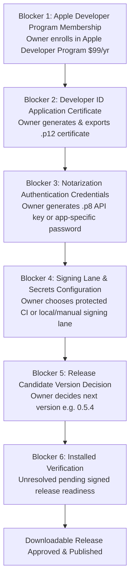

# Mac release preparation for independent review — 4 October 2026

**Independent review accepted:** [Final acceptance](MAC_RELEASE_PREPARATION_ACCEPTANCE_2026-10-04.md) closes RELPREP-R1–R3, including the cleanup failure path. This preparation package is published; signing workflow activation and release publication remain gated. Source/host/preflight statements below describe the recorded implementation sessions.

Prepared from [Claude's release preparation prompt](CLAUDE_MAC_RELEASE_PREPARATION_PROMPT_2026-10-04.md). **This is release preparation, not release publication or installed verification.** No application was launched or installed, no testing account was created or logged into, no keychain or developer credentials were altered, no secret values were inspected or created, and no release draft was replaced or published. Every installed smoke check remains **UNVERIFIED / UNRESOLVED**.

[Evidence inventory and receipts](evidence/mac-release-preparation-2026-10-04/README.md) · [Structured results JSON](evidence/mac-release-preparation-2026-10-04/results.json) · [Proposed signing workflow patch](evidence/mac-release-preparation-2026-10-04/proposed-macos-signing.patch) · [Complete proposed workflow YAML](evidence/mac-release-preparation-2026-10-04/proposed-release-workflow.yml) · [Signing proposal validation receipt](evidence/mac-release-preparation-2026-10-04/signing-proposal-validation.txt) · [Local artifact inspection receipt](evidence/mac-release-preparation-2026-10-04/local-artifact-inspection.txt)

| Item | Value |
| --- | --- |
| Branch / base | `claude/mac-release-preparation-2026-10-04`, tested starting HEAD `50568143a4c4aef04e54eba88bfb22f0974cafe4` |
| Roles | Implementer: Claude (Mac). Reviewer / Git coordinator: Codex. Application owner: Ricky. |
| Owner direction | **“review and no testing account ill wait for the release.”** (Supersedes prior account setup assignment; no installed test or everyday-profile app launch authorized). |
| Owner prerequisites | The owner reports **no Apple Developer Program membership**. No credentials, keychain, or secrets are available. |
| Delivered | Exact candidate and blockers audit; build-only package evidence (local DMG built and inspected read-only, app never launched); read-only preflight runs; reviewable proposed signing workflow patch, complete proposed YAML, and 41-check synthetic validation runner (32 executable behavior cases, 9 structural checks) resolving RELPREP-R2a, R2b, and cleanup failure handling. |
| Overall status | **Pending Codex re-review** (not accepted or release-ready). |

---

## 1. Five levels of release evidence

To ensure release safety and avoid conflating distinct milestones, release readiness is strictly separated into five distinct, non-fungible levels. Passing one level never implies that subsequent levels are satisfied:

| Level | Current status | Evidence / Notes |
| --- | --- | --- |
| **1. Source checks passed** | **PASS** | A1–A6 merged to `main`; PR #78 atomic saves merged; PR #83 native Mac case-alias APFS regression independently passed. Frontend tests, Clippy, Rust harness, and formatting all pass. |
| **2. Package builds observed** | **OBSERVED (Local)** | Local build succeeds (`Her Flight Deck_0.5.3_aarch64.dmg`, 4,561,979 bytes, exit 0). Packaging scripts succeed. This is build evidence, not the frozen candidate and not approved for installation. |
| **3. Signing metadata verified** | **FAIL / ABSENT** | Package has only an ad-hoc linker signature (`0x20002(adhoc,linker-signed)`). No Developer ID Application certificate, no hardened runtime, no secure timestamp. Strict verification fails (`code has no resources but signature indicates they must be present`, exit 1). Disk image container is unsigned (`code object is not signed at all`, exit 1). |
| **4. Notarization & stapling observed** | **UNPERFORMED / UNVERIFIED** | Not submitted to Apple Notary Service; no stapled ticket attached. Gatekeeper assessment (`spctl --assess`) was not run (unperformed). Normal downloadable release requires Apple Developer Program membership and credentials. |
| **5. Normal installed launch observed** | **UNRESOLVED (Held)** | Zero installed app runs. Owner explicitly directed: "review and no testing account ill wait for the release." Installed verification remains unresolved; no testing account or installed test is assigned to the owner. |

---

## 2. Phase 1: Candidate identity, repository state, and release blockers

### 2.1 Current repository and source state

- **Tested starting HEAD commit:** `50568143a4c4aef04e54eba88bfb22f0974cafe4` on branch `claude/mac-release-preparation-2026-10-04`.
- **Working tree state:** Working tree contains uncommitted documentation and evidence artifacts for Codex review. Active application source and `.github/workflows/release.yml` remain completely untouched.
- **Commit ancestry:** Verified that accepted A2 source commit `558725158cd93d49f8f9114693f61b08a00ffe2f` (PR #78) is an ancestor of HEAD.
- **Primary checkout preserved:** Checked `/Users/rickymac/code/Flight-training-` on branch `claude/cool-carson-9wjrub`; untouched and preserved.
- **Consistent repository versions:** Confirmed version `0.5.3` across all 5 version sources:
  1. `package.json`: `0.5.3`
  2. `package-lock.json`: `0.5.3`
  3. `src-tauri/tauri.conf.json`: `0.5.3`
  4. `src-tauri/Cargo.toml`: `0.5.3`
  5. `src-tauri/Cargo.lock`: `0.5.3` (`her-flight-deck` package)
- **Platform distribution policy (`scripts/release-policy.json`):**
  - macOS: `active`, architecture `aarch64`, target bundle `dmg`, minimum macOS `12.0`, candidate `0.5.3`.
  - Windows: `held` on `v0.5.1` (reason: Microsoft Defender security review).
  - Version `0.5.2` is permanently retired.

### 2.2 Existing frozen GitHub release draft (v0.5.3)

GitHub releases were inspected read-only via `gh release view v0.5.3`:
- **Draft status:** `isDraft: true`, `publishedAt: null`.
- **Target commitish:** `41464607ff85d0a4cf0b837c19b400d8392dfec4` (workflow run `36515016063`).
- **Attached assets:**
  1. `Her.Flight.Deck_0.5.3_aarch64.dmg` (4,511,142 bytes, SHA-256 `de81be50122275104ca9e6791162a7bac6cd43a672c5580d5fbc509b5d16efec`).
  2. `SHA256SUMS.txt` (100 bytes, SHA-256 `0485cc9495fd403fb9b099a4e9210ae69dd94b3ff4c0109e8dead0f3ed69dffe`).
- **Draft policy:** This draft is a frozen historical artifact targeting commit `4146460...` (which predates PR #78 A2 atomic saves and PR #80/81/83 verification). **Under the Exact-Installer Invariant, it must not be replaced, republished, deleted, retired, or retargeted.** A build from current source produces different bytes and cannot reuse this draft's identity or approval. Any future build requires a distinct version decision from the owner before build actions.

### 2.3 Remote repository environment and secrets audit

GitHub repository configuration was inspected read-only:
- `gh api repos/rickydeleon49-ui/Flight-training-/environments`:
  - `total_count: 0`, `environments: []`.
  - No deployment environments (such as `macos-signing`) currently exist.
- `gh secret list`:
  - `no secrets found`.
  - Zero repository secrets are configured.

### 2.4 Signing requirements: Tauri and Apple Developer ID

Review of official Tauri v2, Apple Developer, and GitHub Actions documentation:
- **Local development vs. downloadable release:** Personal local development on macOS does **not** require a paid Apple Developer Program membership. Tauri applications compile, bundle, and run locally with ad-hoc signatures. However, a normal **downloadable release distributed outside the Mac App Store** requires cryptographic signing and notarization to pass Apple Gatekeeper without user security overrides.
- **Apple Developer Program enrollment:** Issuance of Developer ID Application certificates and App Store Connect API keys requires an active Apple Developer Program membership ($99/year). Only the Account Holder can create Developer ID Application certificates.
  - *Reference: Apple Developer Program Enrollment* (`https://developer.apple.com/programs/enroll/`)
- **Developer ID Application Certificate:** A cryptographic identity issued by Apple (`Developer ID Application: <Name> (<TEAM_ID>)`) that signs Mach-O binaries and disk images with Apple's root authority.
  - *Reference: Apple Developer ID* (`https://developer.apple.com/developer-id/`)
- **Hardened Runtime & Secure Timestamp:** Required by Apple Notary Service (`flags=0x10000(runtime)` and `--timestamp`).
- **Apple Notary Service (`notarytool`):** Accepts authentication via App Store Connect API Key (`.p8` private key, Key ID, and Issuer UUID) or Apple ID with an app-specific password and Team ID. Apple scans the binary for malware and issues an online notarization ticket.
  - *Reference: Tauri macOS Signing & Notarization* (`https://v2.tauri.app/distribute/sign/macos/`)
  - *Reference: Apple Notarization Guide* (`https://developer.apple.com/documentation/security/notarizing_macos_software_before_distribution`)
- **Stapling (`stapler`):** Attaches the notarization ticket directly to the `.dmg` so Gatekeeper can verify validity offline without network calls.
  - *Reference: Apple Support — Safely open apps on your Mac* (`https://support.apple.com/en-us/102445`)
- **Gatekeeper Enforcement:** On macOS 12+, Gatekeeper blocks unnotarized or ad-hoc signed apps downloaded from the internet. On macOS 15+, manual Control-click workarounds are restricted. Releasing software that requires user security bypasses violates project release policy.
- **Environment protection eligibility:** GitHub deployment environments with required reviewers are available on public repositories and GitHub Enterprise / paid plans. For private repositories on free plans, environment protection rules are not supported; in that scenario, a local manual signing lane or manual branch-dispatch guard is the accepted alternative.
  - *Reference: GitHub Actions — Using environments for deployment* (`https://docs.github.com/en/actions/deployment/targeting-different-environments/using-environments-for-deployment`)

### 2.5 Release blockers hierarchy

The exact sequential blockers between current source and an installed downloadable release:



| Blocker ID | Blocker description | Owner action required | Current status |
| --- | --- | --- | --- |
| **BLOCKER-1** | **Apple Developer Program Membership** | Owner must enroll in Apple Developer Program ($99/year) as Account Holder for downloadable distribution. | **OPEN** (Owner reports no membership) |
| **BLOCKER-2** | **Developer ID Certificate Provisioning** | Generate "Developer ID Application" cert in Apple portal, export `.p12`, set password. | **OPEN** (Waiting on BLOCKER-1) |
| **BLOCKER-3** | **Notarization Credentials Provisioning** | Generate App Store Connect API Key (`.p8`, Key ID, Issuer ID) or Apple ID + app-specific password. | **OPEN** (Waiting on BLOCKER-1) |
| **BLOCKER-4** | **Signing Lane & Secrets Configuration** | In repository settings, create `macos-signing` environment (if GitHub plan allows required reviewers) or adopt owner-approved local/manual lane once reviewed; provision secrets. | **OPEN** (Waiting on BLOCKER-2, BLOCKER-3) |
| **BLOCKER-5** | **Release Version Decision** | Decide version string for new build (e.g. 0.5.4; cannot reuse or retarget frozen v0.5.3). | **OPEN** (Owner decision) |
| **BLOCKER-6** | **Installed Verification** | Owner directed: "review and no testing account ill wait for the release." Installed verification remains unresolved; no testing account or installed test is assigned to the owner. | **UNRESOLVED** (Owner deferred: "ill wait for the release") |

---

## 3. Phase 2: Build-only package evidence

A clean local build was executed to produce packaging evidence without launching or installing the application:

### 3.1 Toolchain and build execution

- **Host:** macOS 27.0.1 (26A434), Apple M5, arm64 native.
- **Node / npm:** Node v22.23.3, npm 10.9.9 (`/opt/homebrew/opt/node@22/bin`).
- **Rust toolchain:** rustc 1.99.0, cargo 1.99.0 (`/opt/homebrew/opt/rustup/bin`).
- **Target SDK:** Explicit SDK 26.5 (`/Library/Developer/CommandLineTools/SDKs/MacOSX26.5.sdk`, `SDKSettings.plist` version 26.5).
- **Build command:**
  ```bash
  export PATH="/opt/homebrew/opt/node@22/bin:/opt/homebrew/opt/rustup/bin:$PATH"
  export SDKROOT="/Library/Developer/CommandLineTools/SDKs/MacOSX26.5.sdk"
  npm run tauri build -- --bundles dmg
  ```
- **Real command exit:** `0`
  - Direct exit receipt: [`docs/evidence/mac-release-preparation-2026-10-04/build-exit.txt`](evidence/mac-release-preparation-2026-10-04/build-exit.txt) (2 bytes `0\n`, SHA-256 `9a271f2a916b0b6ee6cecb2426f0b3206ef074578be55d9bc94f6f3fe3ab86aa`).
- **Build log provenance:**
  - Untouched raw build output: `/tmp/hfd-local-build-2026-10-04.log` (16,160 bytes, SHA-256 `898751ccd92b8e31f0784caa12e2e9d01929ffbf20e3b6de9520801f0cad558d`).
  - Tracked publishable build log: [`docs/evidence/mac-release-preparation-2026-10-04/build-output.txt`](evidence/mac-release-preparation-2026-10-04/build-output.txt) (16,159 bytes, SHA-256 `4205a131cb041f474f1f45c97c22b009fbe915d5a56bb2472410e93748a7a03a`). Exactly one terminal newline was trimmed from raw output; ignore policy is unchanged.
- **Build duration:** Frontend built in 2.05s; Rust release profile compiled and bundled in 1m 37s.

### 3.2 Built artifact identity

- **Classification:** **Local build evidence, not the frozen release candidate and not approved for installation/distribution.**
- **Path:** `src-tauri/target/release/bundle/dmg/Her Flight Deck_0.5.3_aarch64.dmg`
- **Basename:** `Her Flight Deck_0.5.3_aarch64.dmg`
- **Byte size:** `4,561,979 bytes`
- **SHA-256:** `1ac53e566e85043260dbe74ef9d3b90c91460e412e1d88f534947f91396d64c0`

*(Note: Although metadata version reads 0.5.3, these bytes are distinct from the frozen GitHub Release draft asset `Her.Flight.Deck_0.5.3_aarch64.dmg`, which is 4,511,142 bytes with SHA-256 `de81be50...`).*

### 3.3 Read-only mount inspection (app never launched)

The disk image was temporarily mounted read-only (`hdiutil attach -quiet -readonly -nobrowse -mountpoint /tmp/hfd-mnt`) and inspected:
- **Executable path:** `/tmp/hfd-mnt/Her Flight Deck.app/Contents/MacOS/her-flight-deck`
- **Architecture:** `Mach-O thin arm64` (`file` exit 0).
- **Info.plist metadata:**
  - `CFBundleIdentifier`: `com.herflightdeck.app`
  - `CFBundleShortVersionString`: `0.5.3`
  - `LSMinimumSystemVersion`: `12.0`
- **Codesign display (app):**
  - Identifier: `her_flight_deck-a93b8bc5f6195384`
  - Format: `app bundle with Mach-O thin (arm64)`
  - CodeDirectory: `flags=0x20002(adhoc,linker-signed)`
  - Authority: **None (ad-hoc signature)**
  - TeamIdentifier: **not set**
  - Sealed Resources: **none**
- **Codesign verification (`codesign --verify --deep --strict`):**
  - Output: `code has no resources but signature indicates they must be present`
  - Exit code: `1` (strict verification failed as expected for an ad-hoc bundle).
- **Disk image container codesign:**
  - `codesign -dvv "Her Flight Deck_0.5.3_aarch64.dmg"`: `code object is not signed at all` (exit 1).
- **Gatekeeper and Notarization status:**
  - Notarization submission: **unperformed, not submitted**
  - Gatekeeper assessment (`spctl --assess`): **unperformed, not run**
- **Cleanup:** `hdiutil detach /tmp/hfd-mnt` succeeded. Mount point removed. **Zero app launch, zero user profile access.**

### 3.4 Read-only readiness preflight execution

The repository's read-only readiness preflight tool (`scripts/mac-readiness-preflight.mjs`) was executed in separate invocations:
1. **Initial repository preflight (JSON capture at `2026-10-04T22:34:27.232Z`, clean checkout):**
   - File: [`preflight-initial.json`](evidence/mac-release-preparation-2026-10-04/preflight-initial.json)
   - Summary: `10 PASS, 0 FAIL, 2 UNVERIFIED, 3 USER_ACTION`, exit `0`.
2. **Initial repository preflight (Text capture at `2026-10-04T22:38:52.176Z`, dirty checkout after build):**
   - File: [`preflight-initial.txt`](evidence/mac-release-preparation-2026-10-04/preflight-initial.txt)
   - Summary: `8 PASS, 0 FAIL, 4 UNVERIFIED, 3 USER_ACTION`, exit `0` (`R-SOURCE` and `H-TOOLCHAIN` unverified).
3. **DMG artifact inspection (`--artifact`):**
   - Files: [`preflight-local-dmg.json`](evidence/mac-release-preparation-2026-10-04/preflight-local-dmg.json) / [`preflight-local-dmg.txt`](evidence/mac-release-preparation-2026-10-04/preflight-local-dmg.txt)
   - Summary: `10 PASS, 1 FAIL, 8 UNVERIFIED, 3 USER_ACTION`, exit `1`.
   - Failing check: `A-DMG-SIGNATURE: FAIL` (disk image container is unsigned).
   - Gatekeeper check: `A-GATEKEEPER: UNVERIFIED` (assessment not run).
4. **App bundle inspection (`--app`):**
   - Files: [`preflight-local-app.json`](evidence/mac-release-preparation-2026-10-04/preflight-local-app.json) / [`preflight-local-app.txt`](evidence/mac-release-preparation-2026-10-04/preflight-local-app.txt)
   - Summary: `11 PASS, 1 FAIL, 4 UNVERIFIED, 3 USER_ACTION`, exit `1`.
   - Failing check: `A-APP-SIGNATURE: FAIL` (app has ad-hoc signature, failed strict verification, no Developer ID authority).
- All preflight runs honestly recorded missing signatures and owner prerequisites as `FAIL` / `USER_ACTION` / `UNVERIFIED` without masking or weakening checks.

---

## 4. Phase 3: Reviewable signing and release workflow proposal

Because repository environment protections and owner signing credentials are not established, the proposed workflow changes are preserved as an **explicitly non-active review artifact**:
- **Patch path:** [`docs/evidence/mac-release-preparation-2026-10-04/proposed-macos-signing.patch`](evidence/mac-release-preparation-2026-10-04/proposed-macos-signing.patch)
- **Complete proposed YAML:** [`docs/evidence/mac-release-preparation-2026-10-04/proposed-release-workflow.yml`](evidence/mac-release-preparation-2026-10-04/proposed-release-workflow.yml)
- **Target file:** `.github/workflows/release.yml` (active repository workflow remains completely unchanged)
- **Application proof:** Proved read-only application via `git apply --check` (exit 0) and scratch application byte-for-byte identical to `proposed-release-workflow.yml`.
- **YAML AST validation:** Parsed with `yaml` library, verifying step sequencing, job separation, secret containment, and guard logic.
- **Synthetic test runner:** Standalone mock runner [`validate-signing-proposal.mjs`](evidence/mac-release-preparation-2026-10-04/validate-signing-proposal.mjs) executes 41 synthetic validation checks across 5 test suites (32 executable behavior cases, 9 structural/ordering checks) using GitHub's explicit Bash options (`--noprofile --norc -eo pipefail`); all 41 pass exit 0 (receipt: [`signing-proposal-validation.txt`](evidence/mac-release-preparation-2026-10-04/signing-proposal-validation.txt)).

### 4.1 Required secret names (no secret values)

When the owner completes Apple Developer Program enrollment, the following secrets must be configured in GitHub (or used in the owner-approved local/manual alternative lane once reviewed):

| Secret Name | Purpose | Where Owner Obtains It |
| --- | --- | --- |
| `APPLE_CERTIFICATE` | Base64-encoded `.p12` file | Exported from macOS Keychain Access after downloading Developer ID Application certificate |
| `APPLE_CERTIFICATE_PASSWORD` | Password protecting the `.p12` | Chosen by owner during `.p12` keychain export |
| `APPLE_SIGNING_IDENTITY` | Exact identity string: `Developer ID Application: Full Name (TEAM_ID)` | Found on the certificate in Apple Developer portal or Keychain Access |
| `APPLE_TEAM_ID` | 10-character Apple Developer Team ID | Apple Developer portal account membership details |
| `APPLE_API_ISSUER` | App Store Connect API Issuer UUID (if using API key auth) | App Store Connect → Users and Access → Integrations → App Store Connect API |
| `APPLE_API_KEY` | App Store Connect API Key ID (if using API key auth) | App Store Connect → Users and Access → Integrations → App Store Connect API |
| `APPLE_API_KEY_P8` | Contents of `AuthKey_<KEY_ID>.p8` (if using API key auth) | Downloaded once from App Store Connect when generating the API key |
| `APPLE_ID` | Apple ID email (if using password auth) | Owner Apple account email |
| `APPLE_PASSWORD` | App-specific password (if using password auth) | Generated at appleid.apple.com for notarytool |

*(Note: `KEYCHAIN_PASSWORD` is generated randomly per workflow run using `openssl rand -hex 24` and masked; it is never stored).*

### 4.2 Key security features of the proposed patch (resolving RELPREP-R2a & R2b)

1. **Job-level control boundary & secret containment (RELPREP-R2b):**
   - The matrix build job is cleanly divided into separate `build-macos` and `build-windows` jobs.
   - `build-macos` specifies a pre-secret job-level conditional: `if: github.event_name == 'workflow_dispatch' && github.ref == 'refs/heads/main'`. This prevents the macOS runner VM from provisioning, entering the protected `macos-signing` environment, or binding any Apple credential secrets during tag pushes, pull requests, or branch pushes.
   - Apple signing secrets (`APPLE_CERTIFICATE`, `APPLE_CERTIFICATE_PASSWORD`, etc.) are scoped strictly to steps within `build-macos`. The Windows build job (`build-windows`) is uncredentialed and gated separately by `needs.check.outputs.target == 'all'`.
   - The downstream `publish` job depends on `[check, build-macos, build-windows]` with conditional execution requiring at least one build success (`always() && needs.check.result == 'success' && needs.check.outputs.create_draft == 'true' && (needs.build-macos.result == 'success' || needs.build-macos.result == 'skipped') && (needs.build-windows.result == 'success' || needs.build-windows.result == 'skipped') && (needs.build-macos.result == 'success' || needs.build-windows.result == 'success')`).

2. **Ordered keychain preservation & fail-closed capture (RELPREP-R2a):**
   - The setup step executes `raw_list=$(security list-keychains -d user)` without `|| true`. If the query fails, the script immediately halts with exit code 1 before creating or modifying any keychains or search lists.
   - The search list is parsed using `sed` to strip leading/trailing whitespace and surrounding quotes, preserving entries that contain spaces or special characters intact.
   - The unquoted original paths are recorded line-by-line in a deterministic task-owned state file: `$RUNNER_TEMP/hfd-orig-keychains.txt`.
   - Crucially, multiline search paths are **never** written as raw lines to `GITHUB_ENV` (which causes GitHub Actions runner syntax errors).
   - When modifying the search list, `"${orig_keychains[@]}"` is passed as individual quoted elements to `security list-keychains -d user -s "$KC"`.

3. **Deterministic cleanup, failure recovery & independent action resilience (RELPREP-R2a):**
   - The cleanup step (`if: always()`) operates on deterministic task-owned paths: `$RUNNER_TEMP/hfd-signing.keychain-db` and `$RUNNER_TEMP/hfd-orig-keychains.txt`. It does **not** rely on `GITHUB_ENV.TEMP_KEYCHAIN` or state transfer variables, ensuring cleanup succeeds even if setup failed midway or environment export failed.
   - **Independent Action Execution:** Every cleanup operation is isolated so that failure in an earlier action does not abort subsequent cleanup steps under GitHub's explicit `bash --noprofile --norc -eo pipefail`:
     - Keychain deletion failure sets `CLEANUP_FAILED=1` and emits a warning, while continuing to search-list restoration and file removals.
     - State-file reading is protected (`if ! { while ... done < "$STATE_FILE"; }; then`) so unreadable state files emit a warning and set `CLEANUP_FAILED=1` without aborting state file or credential removals.
     - State-file removal (`rm -f "$STATE_FILE" || { ... }`) catches deletion errors, sets `CLEANUP_FAILED=1`, and proceeds directly to credential removals.
     - Task-owned credential files (`$RUNNER_TEMP/AuthKey.p8` and `$RUNNER_TEMP/cert.p12`) are deleted independently with explicit individual guards, ensuring that failure to remove one does not prevent removal of the other.
   - **Aggregate Failure Reporting:** If any cleanup operation encountered an error, the step logs `::error::Signing cleanup encountered one or more errors` and exits with code 1, ensuring failures are never silently swallowed or masked as successful runs.

4. **Fail-closed prerequisites check (shell defense-in-depth):**
   - Even if reached, the first step in `build-macos` verifies event name, ref, and required certificate and notarization secrets. If prerequisites are missing or invalid, the step immediately exits 1 before any keychain creation or build actions.

5. **Flexible notarization authentication:**
   - Supports both Apple-supported authentication options (App Store Connect API key with `.p8` file or Apple ID + app-specific password).

6. **Separate DMG container and mounted app verification:**
   - DMG container: codesign verification, Developer ID authority assertion, TeamIdentifier assertion against `EXPECTED_TEAM_ID`, secure timestamp assertion, and `xcrun stapler validate`.
   - Mounted application bundle: arm64 architecture check, Info.plist metadata (`CFBundleIdentifier == com.herflightdeck.app`, version match, `LSMinimumSystemVersion == 12.0`), codesign deep verification, Developer ID authority assertion, TeamIdentifier assertion, signing identifier assertion, hardened runtime assertion (`flags=.*runtime`), secure timestamp assertion, and Gatekeeper `spctl --assess`.

7. **Strict sequencing:** Artifact upload occurs **strictly after** all verification assertions succeed.

8. **Pipe-safe verification:** All metadata checks use direct variable capture and here-strings (`grep -q ... <<< "$info"`), avoiding SIGPIPE (141) traps under `set -eo pipefail`.

### 4.3 Precise application plan

1. **Owner action:** Enroll in Apple Developer Program ($99/yr) as Account Holder.
2. **Owner action:** Generate Developer ID Application certificate and notarization credentials in Apple portals.
3. **Owner action:** In GitHub repository settings (`Settings → Environments`), create `macos-signing`. If the repository plan permits, configure required reviewers (the owner). Add secret names and values. (If GitHub plan does not support required reviewers on private repositories, adopt the owner-approved local/manual signing lane once reviewed).
4. **Codex action:** Review [`proposed-macos-signing.patch`](evidence/mac-release-preparation-2026-10-04/proposed-macos-signing.patch) and [`proposed-release-workflow.yml`](evidence/mac-release-preparation-2026-10-04/proposed-release-workflow.yml), apply to `.github/workflows/release.yml`, verify with `releaseSafety.test.ts`, and merge to `main`.
5. **Release execution:** Trigger `Release` workflow on `main` via `workflow_dispatch` specifying the decided version string (e.g., `0.5.4`).

---

## 5. Summary for the repository owner

> [!IMPORTANT]
> ### What must happen before a downloadable Mac release can be installed:
> 1. **Apple Developer Program Enrollment:** Personal local development runs on your Mac without paid membership. However, releasing a normal downloadable application that opens without macOS Gatekeeper warnings requires a Developer ID Application certificate and Apple Notarization. These require an Apple Developer Program enrollment ($99/year).
> 2. **Signing Credentials Provisioning:** Once enrolled, you will generate a Developer ID Application certificate and notarization credentials in Apple's portal, and add them as secrets in GitHub (or for a local signing lane). (A complete step-by-step guide with exact secret names is provided in §4).
> 3. **Version Decision:** Current source includes accepted database fixes (A2) that are not present in the older frozen v0.5.3 draft. You will decide on the release version (e.g. 0.5.4) before any future release build actions.
> 4. **Installed Verification (Unresolved):** In accordance with your direction ("review and no testing account ill wait for the release"), installed testing remains unresolved; no account setup or installed test is assigned to you.

The implementation was submitted uncommitted for review. The accepted preparation documents, receipts and inactive proposal are now integrated by the review coordinator; the local implementation checkout is preserved. No signing workflow activation or release publication is authorized by this acceptance.
